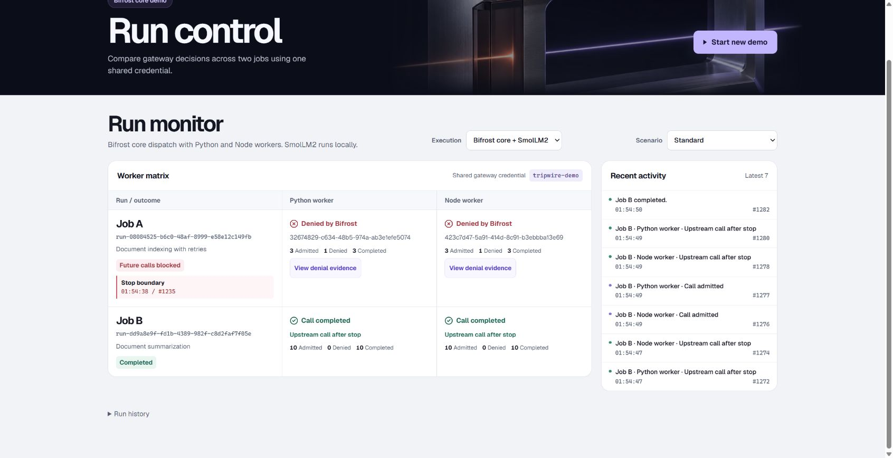

# Bifrost Tripwire

Stop one AI run across Python and Node workers while another run keeps making model calls on the same gateway credential.

**[Live demo — open the full frontend](https://bifrost-tripwire.vercel.app/)**

Explore the animated intro, start a run, stop Job A, and inspect or download
denial receipts. The hosted frontend uses clearly labeled Simulation mode.
Follow the local setup below to run actual Bifrost enforcement and model calls.

[Recorded real enforcement](https://github.com/aaravjj2/bifrost-tripwire/blob/main/media/tripwire-demo.mp4) · [Verification workflow](https://github.com/aaravjj2/bifrost-tripwire/actions) · [Evidence](evidence/)



Tripwire adds an operator screen, a committed stop boundary, and a receipt that separates gateway decisions from independently observed upstream arrivals. The opening is an original Three.js gate animation. The console supports keyboard interaction, reduced motion, refresh recovery, and persisted run history.

## Reproduce the proof

The native verification environment is Linux with Go 1.27.4, a C compiler, Node 24, Python 3, Git, curl and tar. No hosted model key is required. The workflow pins Bifrost revision `3efed2f7995f4f8c12005cda0d773cc6f8a3b60b` and verifies the llama.cpp and model downloads by SHA-256.

```bash
npm ci
npm test
npm run build
mkdir -p .local
git clone --filter=blob:none --no-checkout https://github.com/maximhq/bifrost.git .local/bifrost-source
git -C .local/bifrost-source sparse-checkout set core framework plugins transports
git -C .local/bifrost-source checkout 3efed2f7995f4f8c12005cda0d773cc6f8a3b60b
bash host/build.sh "$PWD/.local/bifrost-source"
bash server/setup-model.sh
TRIPWIRE_PLUGIN_PATH="$PWD/.local/tripwire.so" npm start
```

Open `http://127.0.0.1:4177/`. Start a demo, stop Job A, inspect each denial, and download the receipt. Job B finishes its ten document steps in each worker. Reload during the trial to recover the same run IDs and events.

With the service idle, run these commands in another terminal.

```bash
node server/verify.js 3
node server/compare.js
```

The verifier drains prior admissions before committing stop. It requires two independent A denials, a measured zero for each matching upstream request, later B arrivals and B completion. Incomplete evidence fails verification. The stock comparison uses separate Python and Node processes and the same document workload.

[Host integration and build details](host/README.md) · [Comparison and integration cost](COMPARISON.md) · [Verification record](VERIFICATION.md)

## Hosted frontend

The full interactive frontend runs on [Vercel](https://bifrost-tripwire.vercel.app/),
including the Three.js intro, worker matrix, scenario controls, evidence dialogs
and JSON downloads. This hosted build uses the explicitly labeled browser
Simulation mode. It sends no model requests and does not probe for the local API.
The Vercel project connects this repository's `main` branch with the repository
root, the Vite framework preset, `npm ci`, `npm run build:frontend`, and `dist`
as its output directory. These settings are checked in as `vercel.json`.
The native control service runs through the local setup above.
The original [submitted link](https://aaravjj2.github.io/bifrost-tripwire/)
redirects to the Vercel frontend. The event locks finalized submission fields,
so this redirect updates the destination judges reach from the existing entry.

## Windows demonstration

Use Node 24, Python 3 and Go 1.27.4. Install dependencies, build the UI, run `./plugin/build.ps1`, then `./server/setup-model.ps1`. Start with `npm start`. The Windows demo embeds Bifrost core and invokes the same hook. Its receipt identifies `bifrost-embedded`; Linux shared-object trials identify `bifrost-http-dynamic`.

Windows application control on the source machine blocks the newly built full HTTP host. The working Windows movie therefore shows the embedded engine. The standard HTTP transport and dynamic loader are verified separately in Linux CI. No Windows security setting is changed.

The optional browser-only Simulation mode sends no model requests. It labels events and receipts as simulated. Use that mode for the timeout/reconnect scenario.

## Enforcement and authority

Workers receive one fixed gateway credential plus distinct, expiring run association secrets. The service stores association hashes. The operator service commits stop in SQLite. The post-authentication HTTP hook asks that service before provider dispatch and fails closed when the association or service is unavailable. Worker association credentials are stripped before upstream dispatch. A correlation header joins each decision to the separate forwarding recorder.

The operator session is an HttpOnly, SameSite cookie on a loopback service. Origin checks protect session/data APIs and mutations. A read-only trial is enforced on the server. This is a local demonstration authority boundary; it is not a production identity or multi-tenant authorization system.

A trial admits at most 60 requests across both jobs and workers. The route uses one model with fallback, retries and caching disabled. The recorder caps generation at eight tokens per response. Documents are original synthetic paragraphs in `server/documents.json`. Receipts omit credentials, prompts and model outputs. Model binaries, weights, SQLite state and private configuration stay in ignored `.local/`.

## Boundaries

A stop blocks future admissions. Previously admitted calls may finish. Only the demonstrated non-streaming chat-completion route and one gateway instance are covered. Direct provider traffic, tool side effects, cancellation, billing recovery and multi-replica coordination are outside this release. A service restart invalidates old active associations. Missing recorder coverage leaves the receipt incomplete rather than implying zero arrivals.

The hook adds one control-service HTTP round trip per decision. The checked-in microbenchmarks isolate the adapter and a loopback stub; they exclude SQLite, model execution and production network latency. No throughput advantage is claimed.

## Design and resources

The gate scene is original procedural Three.js geometry, with an original generated still as its fallback. Geist and Lucide are self-hosted with their license notices. [Design references and provenance](DESIGN.md) record the requested galleries and the Apple study.

[Tavily resources](RESOURCES.md) are optional development research. Keep its key in `.local/tavily.env` and run `npm run resources` to refresh the cached source catalog with up to three basic-search credits. The product and proof do not require Tavily. The participant coupon was exhausted, and no bonus-credit claim is made.

## Contribution

[Apache 2.0](LICENSE). Run `npm test` and the native workflow before changing enforcement. Keep gateway decisions distinct from recorder observations, preserve run identity across replay, and keep credentials out of source and evidence. The native adapter uses Bifrost's public plugin interface without modifying upstream source.


